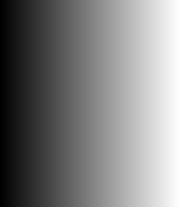
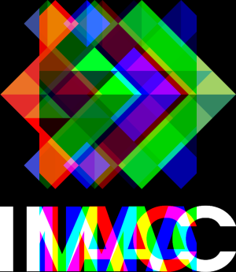
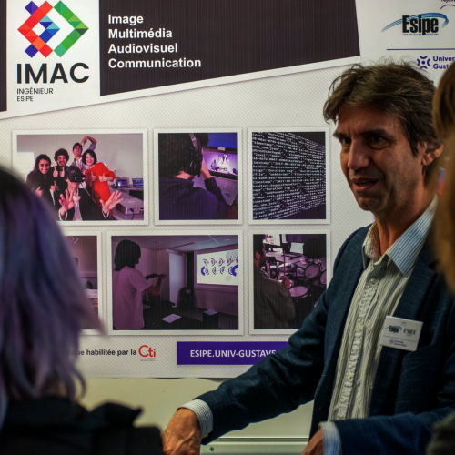
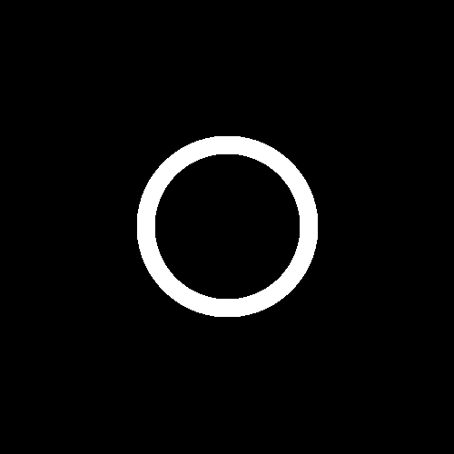
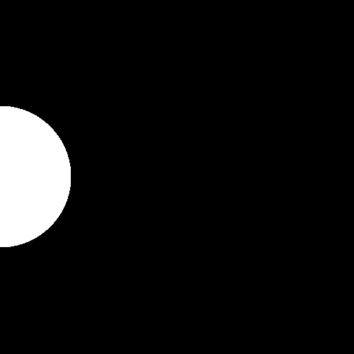
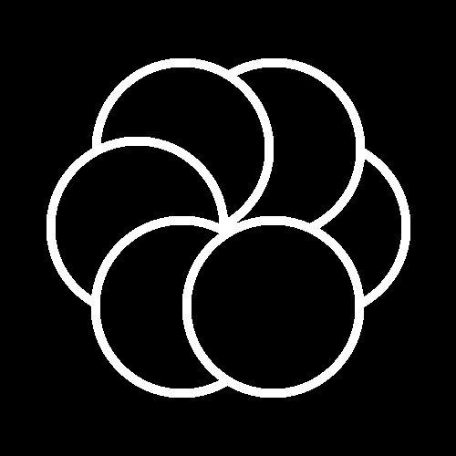
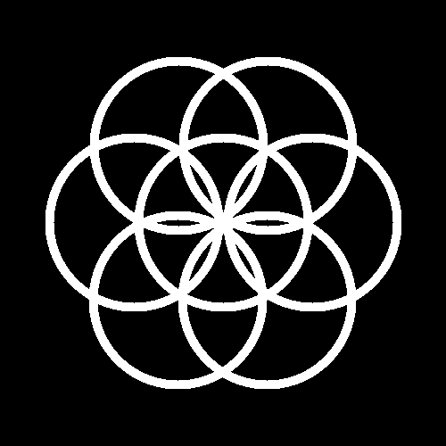
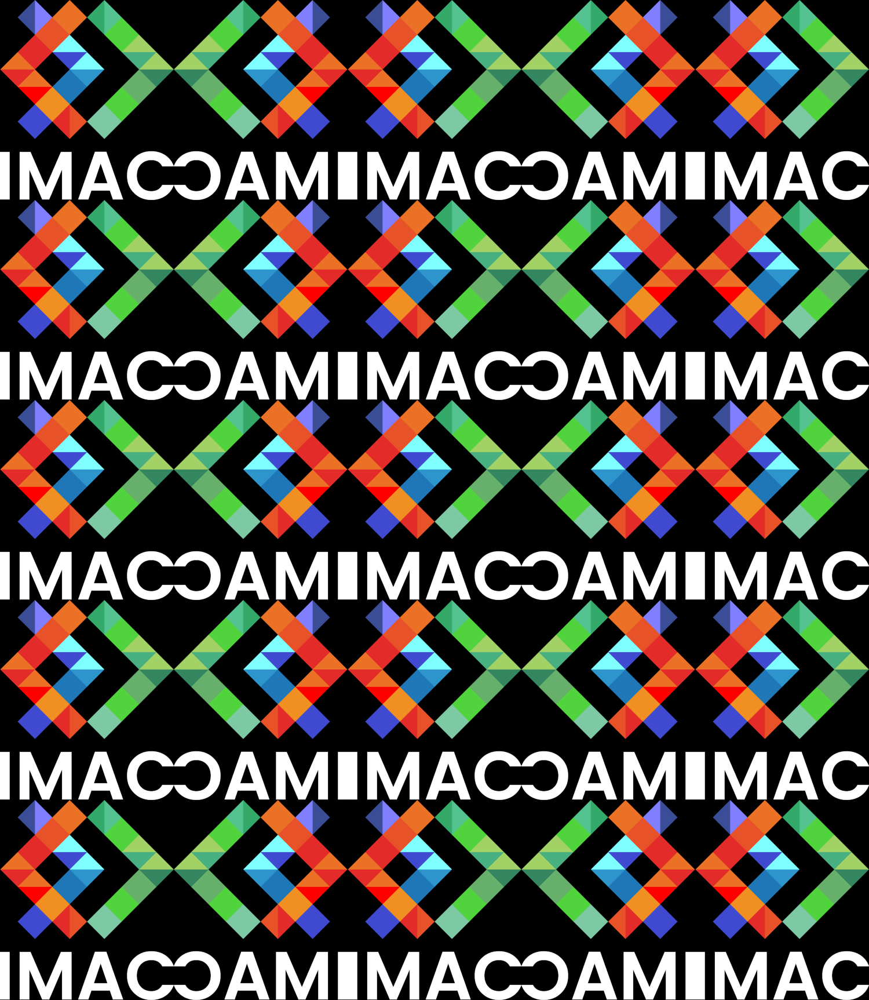
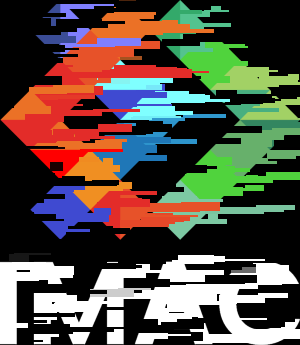
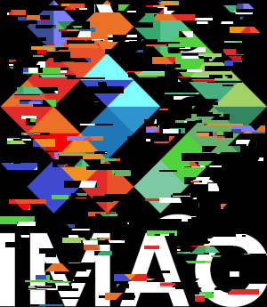

# Workshop C++    Mathias RAKOTOMAVO

[Lien github](https://github.com/Mathyazerty/mathias_workshop)

## 1. Ne garder que le vert

## 2. Échanger les canaux

## 3. Noir & Blanc

## 4. Négatif

## 5. Degrade

## 6.Mirroir

## 7.Image bruitée

## 8. Rotation de 90°

## 9.RGB split

## 10 Luminosité

## 11. Disque

## 12. Cercle

## 13. Animation

## 14. Rosace

J'ai rencontré quelques difficultés au debut, notamment pour gérer le positionnement des cercles sur le coutour du cercle pile au centre.

Et voici quel a été mon premier resultat, le problème ici à été que les cercles avaient tous un cercle noir à l'intérieur d'eux, ce qui créait le contour blanc. Cependant je n'ai pas pu utiliser cette technique ici car les cercles se chevauchent, j'ai donc du calculer et colorer uniquement les pixels situés entre le rayon et la thickness.

## 15. Mosaïque

## 16. Mosaïque miroir

### 17. Glitch

Alors au début j'ai décidé de remplacer des rectangles de couleurs aléatoires plutot que des pixels aléatoires pour tester.

Voici le resusltat, le programme utilisait sa couleur pour peindre un petit rectangle. Cela arrivait environ 300 fois. Les rectangles se recouvraient et repeignaient parfois des zones déjà modifiées, ce qui étalait la couleur des pixels en rectangles, plutôt que de déplacer des morceaux de l’image.

